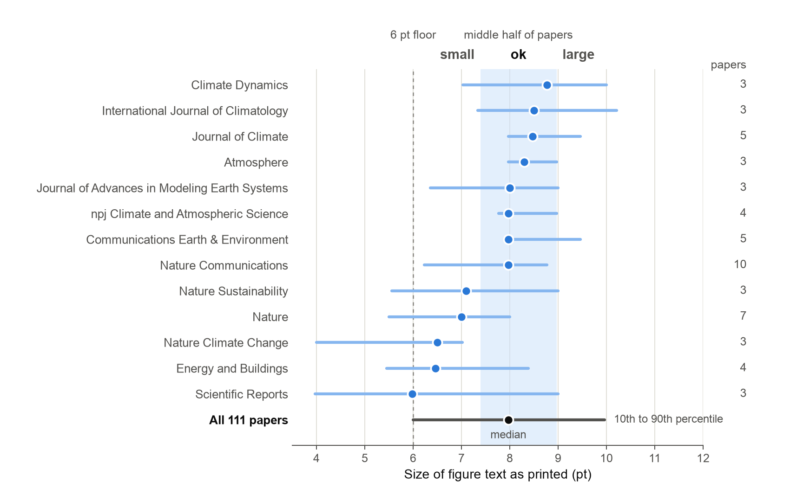
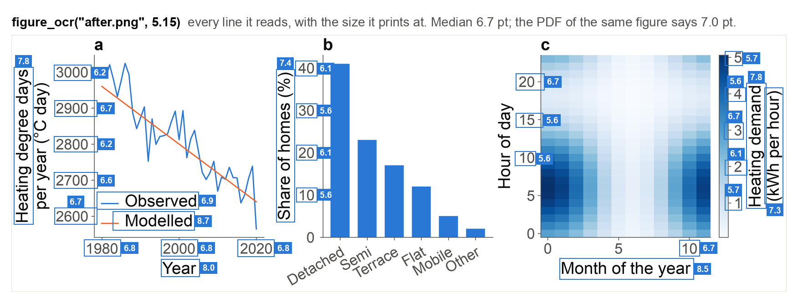
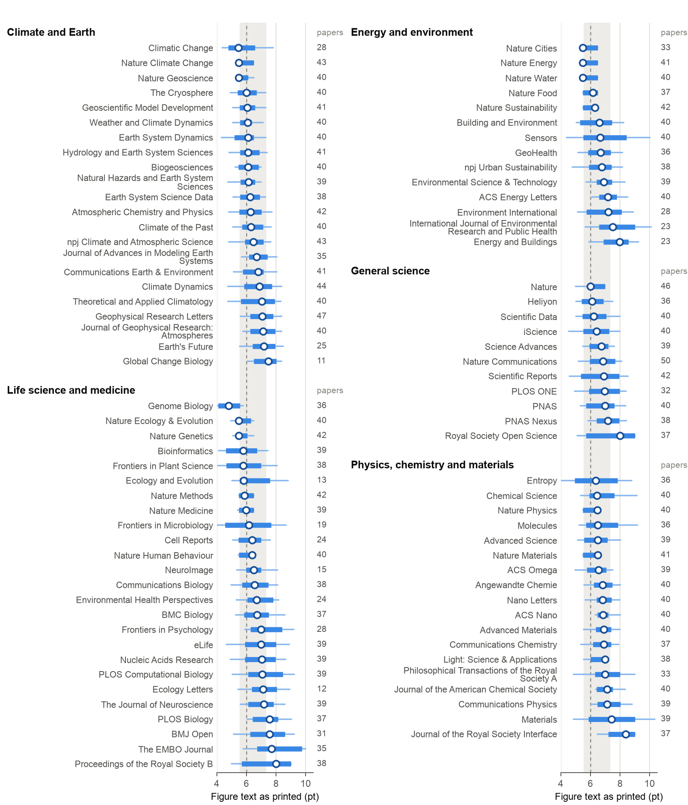
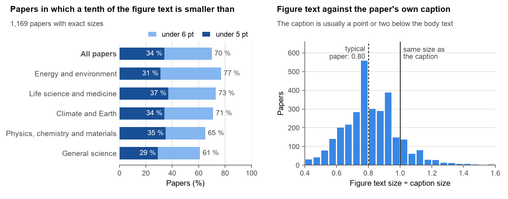
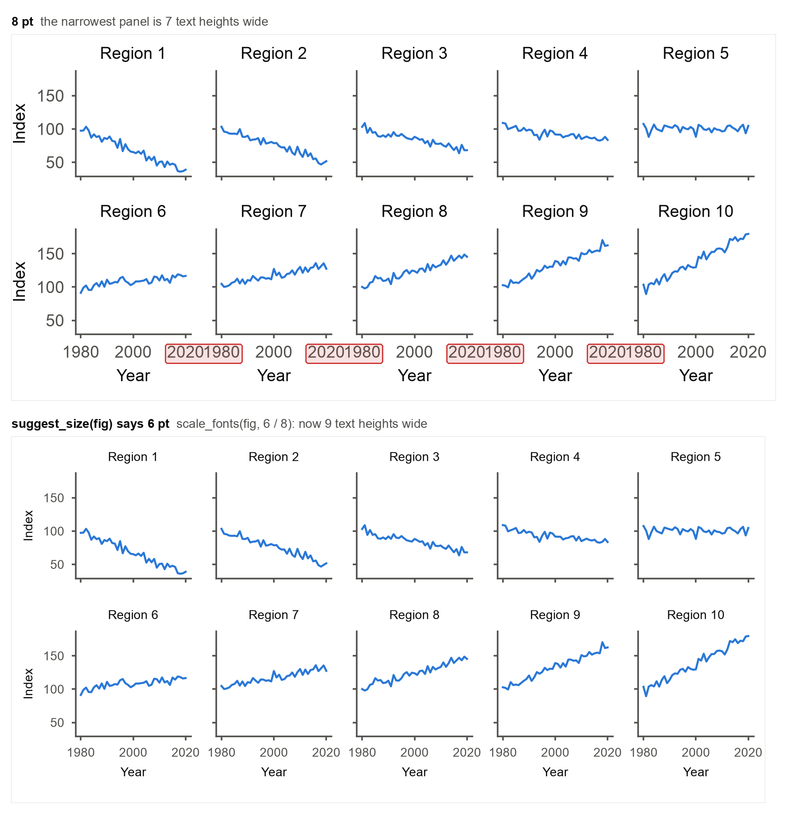
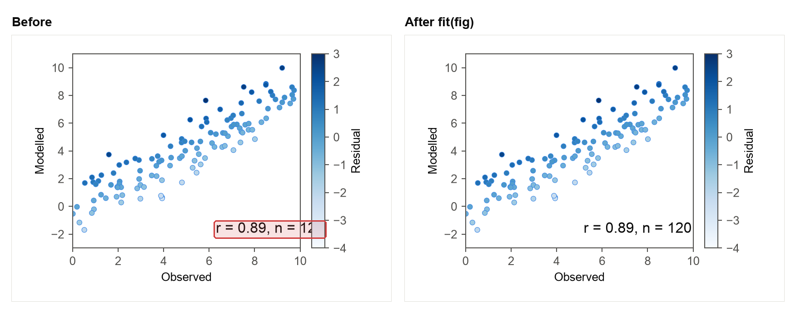
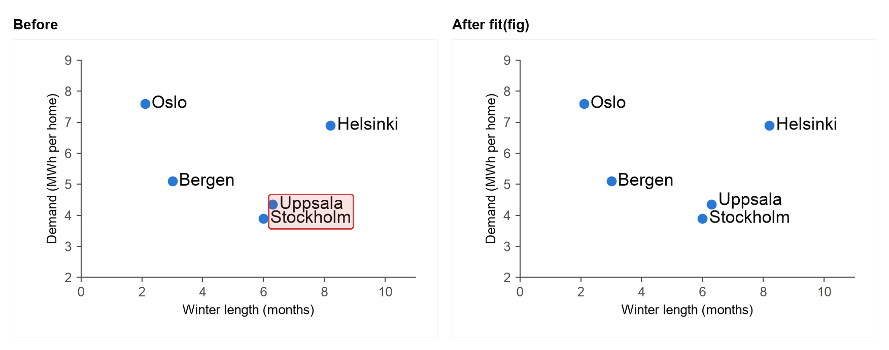
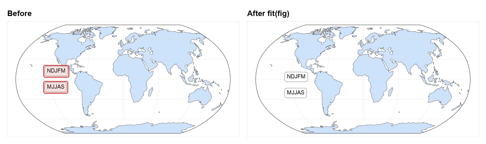
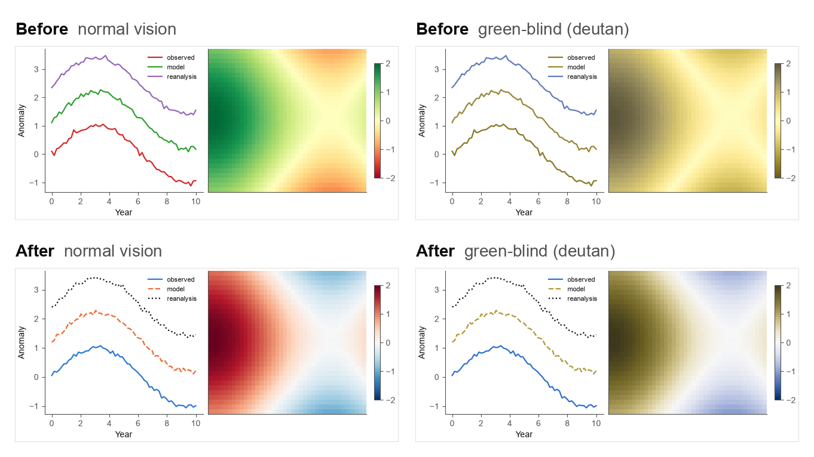

<h1 align="center">figfit</h1>

<p align="center">
  <b>Figures that read well in print.</b><br>
  Measure the text in a figure as it prints, compare it with published papers,<br>
  set the sizes it should have, clear the collisions that bigger text makes,<br>
  and check that colour-blind readers can tell its colours apart.
</p>

<p align="center"><sub>Called figfont up to version 0.3.0.</sub></p>

<p align="center">
  
  
  
  
</p>

<h2 align="center">How big is the text in a published figure? About 6.5 pt.</h2>

<p align="center">
  figfit measured the figures of <b>3,363 journal articles from 132 journals</b>, as they print on the page.<br>
  Half of the papers have figure text between 5.5 and 7.4 pt, and the five fields are within half a point of each other.<br>
  Only one paper in ten is under 5 pt. A figure drawn wide and shrunk to fit a column often is.
</p>

<p align="center">
  
</p>

<p align="center">
  <a href="#3-compare-with-published-papers">How it was measured</a> &middot;
  <a href="docs/reference.md">The numbers for 90 journals</a>
</p>

<h3 align="center">
  <a href="docs/tour.ipynb">Start here: the notebook tour &rarr;</a>
</h3>

<p align="center">
  It starts with the problem: what your figure's text looks like on the journal's page.<br>
  Then it fixes one figure step by step and says what every number means. It reads on GitHub as it is.
</p>

<p align="center">
  
</p>

| Start with | What it is |
|---|---|
| [**Notebook tour**](docs/tour.ipynb) | The problem, then one figure fixed step by step, with every output explained. You only need to know matplotlib |
| [Quick start](#quick-start) | The three lines most figures need |
| [Reference](#1-work-out-the-size) | Each function with a picture of what it does |

## Why

A figure drawn 13 in wide and placed 5.15 in wide on the page is shrunk to 40 % of its size, and
its text shrinks with it. Text set at 10 pt prints at 4 pt. Figures in published papers print at
about 6.5 pt, and nine in ten papers are at 5 pt or more.

Making the text bigger fixes the size and breaks the layout. Labels land on each other, on the
next panel, or run off the figure. figfit does both jobs, and checks the colours too:

| | Job | Functions |
|---|---|---|
| 1 | [Work out the size](#1-work-out-the-size) a font prints at, and the size to draw it at | `printed_pt` `drawn_pt_for` `font_scale_for` `panel_width_for` `stitched_width` |
| 2 | [Measure what prints](#2-measure-what-prints), from a figure file or a compiled paper | `figure` `figure_pdf_text` `figure_ocr` `pdf_figure_text` `paper_figures` |
| 3 | [Compare with published papers](#3-compare-with-published-papers) | `reference` `verdict` `journals` `fields` |
| 4 | [Set the printed sizes](#4-set-the-printed-sizes) on a matplotlib figure | `set_printed_fonts` `scale_fonts` |
| 5 | [Pick a size for small panels](#5-pick-a-size-for-small-panels) | `suggest_size` `density` |
| 6 | [Find colliding text](#6-find-colliding-text) | `overlaps` `report_overlaps` |
| 7 | [Fix colliding text](#7-fix-colliding-text) with the smallest change that works | `fit` `clear_notes` |
| 8 | [Check colours for colour-blind readers](#8-check-colours-for-colour-blind-readers) | `colour_problems` `colormap_problems` `image_problems` `colourblind_sheet` |

There is also a [command line](#command-line) for checking figure files and compiled papers.

## Install

```bash
# macOS, with OCR by Apple Vision
pip install "figfit[mac] @ git+https://github.com/jake-casselman/figfit"

# Linux and Windows, with OCR by tesseract (the tesseract command must be installed)
pip install "figfit[tesseract] @ git+https://github.com/jake-casselman/figfit"

# no OCR: vector PDFs and matplotlib figures only
pip install git+https://github.com/jake-casselman/figfit
```

Python 3.10 or later. It installs matplotlib, numpy, pillow and pymupdf. OCR is only used to
measure images (PNG, JPEG) and PDFs whose text is stored as shapes.

## Quick start

```python
import figfit
from figfit.mpl import set_printed_fonts

fig = ...                                    # any matplotlib figure, drawn as usual

set_printed_fonts(fig, printed_width=5.15)   # ticks 7 pt, everything else 8 pt, as printed
figfit.fit(fig, "fig01")                    # clear the collisions the bigger text made
fig.savefig("fig01.pdf")
```

`fit` prints what it changed and what is left:

```text
TEXT FIXED fig01: wrap 2, pads 6, ticks 4
TEXT OK fig01: no overlaps
```

Then measure the file the way a reader will see it:

```python
figfit.figure("fig01.pdf", printed_width=5.15).summary()
# {'name': 'fig01.pdf', 'method': 'text', 'n': 43, 'median_pt': 7.0, 'p10_pt': 7.0, 'p90_pt': 8.0}
```

The full script is [`docs/examples/quickstart.py`](docs/examples/quickstart.py). It draws the
three-panel figure at the top of this page in matplotlib's own style.

The [notebook tour](docs/tour.ipynb) takes that same figure from first draft to the page one step
at a time, and says what each number it prints means. The sections below are the reference for
each function.

---

## 1. Work out the size

Text scales with the figure: `printed size = drawn size × printed width ÷ drawn width`. Five small
functions do this arithmetic in both directions. Widths are in inches and sizes in points.

<p align="center">
  
</p>

| Call | Result | Meaning |
|---|---|---|
| `printed_pt(10, 13, 5.15)` | `3.96` | 10 pt text on a 13 in figure prints at 3.96 pt on a 5.15 in page |
| `drawn_pt_for(8, 13, 5.15)` | `20.19` | draw at 20.19 pt to print at 8 pt |
| `font_scale_for(8, 3.96)` | `2.02` | or multiply every font by 2.02 |
| `panel_width_for(5.15, columns=3, gap=0.15, margin=0.1)` | `1.55` | each of three panels gets 1.55 in of the page |
| `stitched_width(1.55, columns=3, gap=0.15, margin=0.1)` | `5.15` | three 1.55 in panels side by side are 5.15 in wide |

`stitched_width` and `panel_width_for` are for figures put together from separate panel images.
The width that counts is the width of the whole stitched figure, not of one panel.

## 2. Measure what prints

`figure(path, printed_width)` returns the size of every piece of text in a figure file, as it
prints when the figure is placed `printed_width` inches wide.

```python
result = figfit.figure("after.pdf", printed_width=5.15)
result.median            # 7.0
result.percentile(10)    # 7.0
result.summary()
# {'name': 'after.pdf', 'method': 'text', 'n': 45, 'median_pt': 7.0, 'p10_pt': 7.0, 'p90_pt': 8.0}
```

It reads the sizes in one of two ways, and `result.method` says which:

| Method | Used for | How | Function |
|---|---|---|---|
| `text` | vector PDFs | the font sizes stored in the file, scaled to the printed width. Exact. | `figure_pdf_text` |
| `ocr` | PNG and JPEG images, and PDFs with fewer than five pieces of stored text | the figure is rendered at its printed width, the text is read off the pixels, and the height of each line is converted to points | `figure_ocr` |

<p align="center">
  
</p>

OCR reads text written across the page and text on its side, such as a y-axis label. Its median
here is 6.7 pt, where the PDF of the same figure says 7.0 pt. See
[Accuracy and limits](#accuracy-and-limits).

### Figures inside a compiled paper

`pdf_figure_text("paper.pdf")` measures the figures where they sit in the finished paper, so it
needs no width. It looks for the places where something is drawn on a page that has a figure
caption, and keeps the text in or right beside them that is not in one of the paper's own fonts.
The body text and the captions are left out.

<p align="center">
  
</p>

`paper_figures("paper.pdf")` gives the same text one figure at a time, with the rest of what it
found in the paper:

```python
found = figfit.paper_figures("paper.pdf")
found["body_pt"], found["caption_pt"]     # (10.0, 9.0): the size of the paper's main text and captions
for f in found["figures"]:                # one entry for each figure that stores its text
    f["page"], f["width_in"]              # (1, 5.16): the page, and the width the figure prints at
    f["sizes"]                            # the size of each of its 45 pieces of text, in points
found["no_text"]                          # []: the figures with no text to read
```

A figure lands in `no_text` when the PDF holds it as an image, or holds its letters as drawn
shapes. That is common: about two papers in three are like this (see
[section 3](#3-compare-with-published-papers)). Measure such a figure from its own file, with
`figure` or `figure_ocr`.

Every other measuring function returns a `Result`:

| Attribute | Meaning |
|---|---|
| `result.sizes` | the printed size of each piece of text, in points |
| `result.n` | how many pieces were found |
| `result.median` | the median size |
| `result.percentile(q)` | any percentile; the 10th shows the smallest text |
| `result.summary()` | a dict with the name, method, count, median, 10th and 90th percentile |

## 3. Compare with published papers

figfit ships with the printed size of figure text in 3,363 journal articles from 132 journals,
nearly all published from 2022 to 2025. Each paper counts once, with the median size of the labels
in its figures.

| | |
|---|---|
| The typical paper | 6.5 pt |
| Half of the papers | 5.5 to 7.4 pt |
| 8 in 10 papers | 5.0 to 8.4 pt |
| The five fields | 6.3 pt (climate and Earth) to 6.8 pt (physics, chemistry and materials) |

<p align="center">
  
</p>

Journals differ more than fields do. The 90 journals with ten or more papers have their own
numbers, from 4.8 pt (Genome Biology) to 8.4 pt (Journal of the Royal Society Interface). The
thick bar is the middle half of a journal's papers, the thin line 8 in 10 of them, and the grey
band the middle half of all papers.

<p align="center">
  
</p>

The same numbers as a table: [`docs/reference.md`](docs/reference.md).

### Ask for the numbers

```python
figfit.reference()
# {'papers': 3363, 'median_pt': 6.5, 'p10_pt': 4.39, 'p90_pt': 9.0,
#  'paper_medians_p25_p75': [5.54, 7.35], 'paper_medians_p10_p90': [5.03, 8.37], 'read_by_ocr': 0.65,
#  'small_text': {'papers': 1169, 'typical_smallest_pt': 5.5,
#                 'share_with_text_under_6pt': 0.7, 'share_with_text_under_5pt': 0.34},
#  'within_a_paper': {'papers': 1169, 'small_end_pt': 5.5, 'typical_pt': 6.5, 'large_end_pt': 7.0},
#  'relative_to_caption': 0.8, 'relative_to_body': 0.71, 'journals': 132}

figfit.reference("Nature")["median_pt"]                                 # 6.0
figfit.reference(field="Climate and Earth")["paper_medians_p25_p75"]    # [5.5, 7.09]
figfit.fields()            # the five field names
figfit.journals()          # the 90 journal names
```

| Key | Meaning |
|---|---|
| `papers` | how many papers the numbers come from |
| `median_pt` | the typical paper: the median of the papers' own medians |
| `paper_medians_p25_p75` | the middle half of the papers. `verdict` uses this range |
| `paper_medians_p10_p90` | 8 in 10 papers |
| `p10_pt`, `p90_pt` | the small and large end of all labels put together (at most 200 from one paper) |
| `read_by_ocr` | the share of the papers that had to be read by OCR |
| `small_text` | the small end, from the papers with exact sizes (below) |
| `within_a_paper` | the small end, the typical size and the large end inside one typical paper |
| `relative_to_caption`, `relative_to_body` | figure text size divided by the paper's caption size, and by its body text size |

A journal name that has no numbers of its own gives the numbers for all papers.

### Give a figure a verdict

```python
figfit.verdict(figfit.figure("before.pdf", 5.15))
# {'name': 'before.pdf', 'method': 'text', 'n': 52, 'median_pt': 3.96, 'p10_pt': 3.96, 'p90_pt': 3.96,
#  'reference_median_pt': 6.5, 'reference_range_pt': [5.54, 7.35],
#  'verdict': 'small', 'scale_to_reference': 1.64}
```

| Verdict | When |
|---|---|
| `small` | the median is below the middle half of papers, or a tenth of the text is under 6 pt (`smallest_ok`) |
| `ok` | the median is inside the middle half of papers |
| `large` | the median is above it. Nothing is wrong with that; the text just takes more room than in most papers |

`scale_to_reference` is the factor that would bring the figure's median to the published median.
Pass `journal="Nature"` or `field="Climate and Earth"` to compare with one journal or one field.

### The small end, and the caption

<p align="center">
  
</p>

These come from the 1,169 papers with exact sizes.

- Inside one typical paper, the labels run from 5.5 pt at the small end to 7.0 pt at the large
  end, with 6.5 pt in the middle.
- In 70 % of the papers a tenth of the figure text is under 6 pt, and in 34 % it is under 5 pt.
  Much of that is subscripts, superscripts and the numbers on colour bars. So the 6 pt that
  `verdict` uses for `smallest_ok` is stricter than what gets published. Pass `smallest_ok=5` to
  follow the papers.
- Figure text is 0.8 of the size of the paper's own caption, and 0.7 of its body text.
- Two sizes are used far more than any other: 6.5 pt (21 % of all labels) and 5.5 pt (20 %).

### How the papers were measured

- `paper_figures` finds the figures on each page and reads the text stored in them. The size is
  the one on the journal's page, so no width has to be known.
- 35 % of the papers store their figure text, and their sizes are exact. The other 65 % hold
  their figures as images. Those were read by OCR, from up to four figures in each paper.
- OCR reads a little large. On 2,051 figures where both the stored text and OCR could be read,
  OCR was 4 % too large, so every OCR size was divided by 1.04. After that the two groups agree:
  the typical paper is 6.5 pt in both.
- 3,704 papers were read. 341 are left out: 328 had no figure text that could be read
  (photographs, too few labels, or no figures), 11 had main text under 7 pt or over 12.5 pt, so
  were not set like a journal page, one was there twice and one could not be opened.
- Of the 3,704 papers, 2,616 are open-access articles from PubMed Central, 433 from Nature
  Portfolio, 400 from Copernicus and 120 from Springer. The other 135 are from the author's own
  library.

[`figfit/reference.json`](figfit/reference.json) holds summary numbers only. Up to version 0.2.3
it held 111 papers and gave 8 pt. Those papers were read from stored text only, and 64 of them
have no stored figure text, so much of that number came from other text on the page.

## 4. Set the printed sizes

`set_printed_fonts(fig, printed_width)` sets every piece of text in a matplotlib figure so that it
prints at a chosen size, whatever width the figure was drawn at.

<p align="center">
  
</p>

```python
from figfit.mpl import set_printed_fonts, scale_fonts

set_printed_fonts(fig, printed_width=3.4)                       # the defaults below
set_printed_fonts(fig, printed_width=3.4, sizes={"tick": 8})    # change one of them
```

| Key | Text | Default |
|---|---|---|
| `tick` | tick labels, colour-bar numbers, axis offset text | 7 pt |
| `label` | axis labels and colour-bar labels | 8 pt |
| `title` | panel titles: centre, left and right | 8 pt |
| `legend` | legend entries and legend titles, on a panel or on the figure | 8 pt |
| `other` | everything else: notes in a panel, figure titles, panel letters | 8 pt |

These defaults are in the upper part of what is published (half of the papers are between 5.5
and 7.4 pt), and a figure set this way gets the verdict `ok`. To match the typical paper instead:

```python
set_printed_fonts(fig, printed_width=3.4,
                  sizes={"tick": 6, "label": 6.5, "title": 6.5, "legend": 6.5, "other": 6.5})
```

`scale_fonts(fig, factor)` multiplies the size of every piece of text by one factor, which keeps
the differences between them.

## 5. Pick a size for small panels

The sizes in section 4 suit a figure with a few large panels. On a grid of small panels, 8 pt
words are as big as the panels and the tick labels run into each other.

`suggest_size(fig, printed_pt=8)` measures how wide each panel is in heights of its own text. It
picks the size that makes the narrowest panel 15 text heights wide, and keeps it between 6 and
8 pt. The grid below would need less than 4 pt, so it gets 6 pt, the smallest size allowed.

<p align="center">
  
</p>

```python
size = figfit.suggest_size(fig, printed_pt=8)    # 6.0 for the grid above
scale_fonts(fig, size / 8)
```

`density(fig)` returns the measurements behind it. `ems_min` is the width of the narrowest panel
in text heights and `panel_ems` the width of each panel. `panels` is the area of each panel's
labels (ticks, axis labels, legend) as a share of its plot area.

The target of 15 was set by eye on the figures of one paper: those that read well had panels at
least 15 text heights wide, and the two that did not had 10 and 11. Change it with `target=`, and
the limits with `low=` and `high=`.

## 6. Find colliding text

`overlaps(fig)` lists every piece of text that touches another piece of text or lies on a
neighbouring panel. With `edges=True` it also lists text that runs off the figure. Leave that
off when saving with `bbox_inches="tight"`, which grows the figure to hold such text.

<p align="center">
  
</p>

```python
for text, other, why in figfit.overlaps(fig, edges=True):
    ...                                   # the Text, what it touches, and the kind of collision

figfit.report_overlaps(fig, "peaks.png", edges=True)    # prints them, returns how many
```

```text
TEXT OVERLAP peaks.png: 'The peak comes later each year' <-> '3.0'
TEXT ON ANOTHER PANEL peaks.png: 'The peak comes later each year' <-> a neighbouring panel
TEXT OFF THE FIGURE peaks.png: 'Change since 1980 (%)'
```

Put `report_overlaps` at the end of a figure script and no figure is saved with text on top of
text unseen.

## 7. Fix colliding text

`fit(fig)` finds every collision and fixes it with the smallest change that works. It never
changes a font size, a colour, the data or the wording. It never changes the width of the figure
either, because the width sets the print scale.

```python
left = figfit.fit(fig, "fig04")    # prints what it did; returns the number of collisions left
```

It works through ten steps in this order, and goes round again while anything still touches.

| Step | What it fixes | What it does |
|---|---|---|
| [`cover`](#cover) | a legend lying on the data | moves it to an empty corner, or under the panel |
| [`wrap`](#wrap) | a long title or label that touches other text or runs off the figure | puts it on two lines |
| [`pads`](#pads) | an axis label touching its tick numbers | moves the label out |
| [`letters`](#letters) | a panel letter on a title or label | moves the letters of that column clear |
| [`ticks`](#ticks) | tick labels touching their neighbours | tilts them |
| [`inside`](#inside) | a note running out of its panel | moves it back in |
| [`repel`](#repel) | two notes in one panel on top of each other | pushes them apart |
| [`legends`](#legends) | a legend touching a label or title | moves the legend away |
| [`space`](#space) | text touching the next panel's text | adds space between the panels |
| [`notes`](#notes) | a boxed note cutting into something drawn | moves it the shortest way clear |

### cover

A legend whose text lies on what its panel draws (a map, bars, a filled band) moves to an empty
corner of the panel. When the panel has no empty corner, it goes under the panel with its entries
in a row. Background bands and grid lines do not count as data.

<p align="center"></p>

### wrap

A panel title, axis label or colour-bar label that is longer than its panel and touches other
text, or runs off the figure, goes onto two lines. The words stay the same.

<p align="center"></p>

### pads

An axis label or colour-bar label keeps a gap of 0.3 of its font size from its tick numbers. A
gap set in points does not grow when the font does.

<p align="center"></p>

### letters

A panel letter that lies on a title or an axis label moves clear of it. The other letters in its
column move with it, so they stay in line.

<p align="center"></p>

Letters and titles placed with `fig.text` need a tag so `fit` knows which panel they belong to.
The offsets are in figure fractions from the panel's top-left corner:

```python
letter = fig.text(x, y, "a", fontweight="bold")
letter._panel = {"axis": ax, "kind": "letter", "dx": -0.02, "dy": 0.01}    # or "kind": "title"
```

### ticks

Tick labels that touch their neighbours tilt 30 degrees. If they still touch, they tilt to 45, 60
or 90. Two-line tick labels go onto one line first.

<p align="center"></p>

### inside

A note inside a panel that runs past the side of the panel moves back in.

<p align="center"></p>

### repel

Two notes in one panel that touch are pushed apart.

<p align="center"></p>

### legends

A legend that touches a label or a title moves away from it.

<p align="center"></p>

### space

Text that still touches the text of a neighbouring panel gets more space between the panels, a
step at a time. Panels side by side get more space between them. Rows get more space and a
taller figure.

<p align="center"></p>

### notes

A note with a box round it, such as a season label on a map, that cuts into the edge of something
drawn (a coast, a curve) moves the shortest way clear of it. Notes set in line with it move too,
so they stay in line. A note never moves onto or over a line drawn right across its panel, such
as an equator or a zero line. In a gap too narrow for the usual clearance, it takes the place
with the most room round it. A note may sit on specks smaller than itself (islands, markers), and
a note written on the data on purpose stays where it is. `clear_notes(fig)` runs this step on its
own.

<p align="center"></p>

On cartopy maps, call `figfit.textfit.pad_cartopy_labels()` once before drawing. Cartopy redraws
its coordinate labels on every draw, so the gap between them has to be cartopy's own rule.

### What fit prints

| Line | Meaning |
|---|---|
| `TEXT DENSITY name: …` | the panel measurements from `density`, before any change |
| `TEXT FIXED name: wrap 2, pads 6` | the steps that changed something, and how many times |
| `TEXT OK name: no overlaps` | nothing touches |
| `TEXT OVERLAP name: 'a' <-> 'b'` | two pieces of text still touch |
| `TEXT ON ANOTHER PANEL name: …` | text still lies on a neighbouring panel |
| `TEXT OFF THE FIGURE name: …` | text runs off the figure (with `edges=True`) |
| `TEXT ON DATA name: …` | a boxed note has no clear place near it and was left where it is |

`fit(fig, quiet=True)` prints nothing and returns the number of collisions left.

## 8. Check colours for colour-blind readers

About 1 man in 12 and 1 woman in 200 sees colour differently. Most of them confuse red and green;
a few confuse blue and yellow. A figure that tells its lines or bars apart by red and green alone
loses those readers, and so does a colour map whose two sides turn into the same colour.

`colour_problems(fig)` simulates the three kinds of colour blindness (protan, deutan, tritan, with
the matrices of Machado et al., 2009) and measures how different two colours then look. It checks,
panel by panel, every pair of colours that names something (lines, points, bars, filled areas and
legend entries), and every colour map used for data.

<p align="center">
  
</p>

```python
import figfit

for problem in figfit.colour_problems(fig):
    print(problem)
```

```text
COLOUR: panel a: 'observed' and 'model': #d62728 and #2ca02c look alike to green-blind (deutan) readers (difference 3.9, want 8+)
COLOUR: panel b: colour map 'RdYlGn': its two sides look alike to green-blind (deutan) readers (most different pair 5); use a blue-red or purple-green diverging map (RdBu, PuOr, BrBG)
```

The difference is the distance between the two colours in OKLab, times 100: about 1 is just
noticeable, and 8 or more reads as clearly different next to each other in a legend. A pair that
also differs by line style, marker or hatch is reported as a note only (`problem.serious` is
`False`), because those readers can still tell the two apart.

Colour maps get their own checks (`colormap_problems("jet")` works on a name alone):

| The map | Is reported when |
|---|---|
| a rainbow (`jet`, `turbo`, `rainbow`, `hsv`, `Spectral`, …) | always: lightness goes up and down, so equal steps don't look equal |
| diverging (light in the middle) | its two sides look alike to one kind of reader, as `RdYlGn` and `PiYG` do |
| sequential | its lightness changes too little from end to end, or goes back and forth |

For a figure you only have as a file, `image_problems(path)` finds the flat colours in a PNG or
PDF (lines, markers, bars, legend keys, filled areas) and reports pairs that are clearly different
to most readers but alike to colour-blind ones, worst first. It can't know what each colour means,
so treat each pair as a place to look: two colours in different panels may never need telling
apart, and a smooth colour map is not seen at all. `colourblind_sheet(path)` saves the figure as each
kind of reader sees it, side by side, which is the quickest way to judge.

---

## Command line

```console
$ figfit check before.pdf after.pdf
published papers: median 6.5 pt, middle half of papers 5.54-7.35 pt
  before.pdf                       median  3.96 pt (1.0 mm caps)  p10  3.96  SMALL  x1.64
  after.pdf                        median  7.00 pt (1.7 mm caps)  p10  7.00  OK     x0.93
```

Each line gives the median size, the height of a capital letter at that size, the 10th
percentile, the verdict, and the factor that would bring the median to the published median.

The median of a figure is mostly its tick numbers, because there are more of them than of
anything else. `x0.93` for `after.pdf` says its text is a little larger than in the typical
paper: every font times 0.93 would put it on the published median.

Compare with one journal or one field:

```console
$ figfit check after.pdf --journal "Nature"
published papers (Nature): median 6.0 pt, middle half of papers 6.0-7.0 pt
  after.pdf                        median  7.00 pt (1.7 mm caps)  p10  7.00  OK     x0.86

$ figfit check after.pdf --field "Climate and Earth"
published papers (Climate and Earth): median 6.28 pt, middle half of papers 5.5-7.09 pt
  after.pdf                        median  7.00 pt (1.7 mm caps)  p10  7.00  OK     x0.9
```

A width goes after `@`, in inches, or once for all files with `--width`. Without one, the width is
372 pt (5.17 in), a common text width. Images are read with OCR:

```console
$ figfit check after.png@5.15
published papers: median 6.5 pt, middle half of papers 5.54-7.35 pt
  after.png                        median  6.66 pt (1.6 mm caps)  p10  5.63  SMALL  x0.98
```

This is the same figure as `after.pdf`. OCR reads its smallest text as 5.6 pt where the PDF says
7 pt, and that takes the verdict to `small`. When there is a PDF, measure the PDF.

A compiled paper needs no width:

```console
$ figfit paper paper.pdf
published papers: median 6.5 pt, middle half of papers 5.54-7.35 pt
  paper.pdf                        median  7.00 pt (1.7 mm caps)  p10  7.00  OK     x0.93
```

Colours that colour-blind readers can't tell apart, with `--sheet` to save how each kind of
reader sees the figure (exit code 1 when anything is found):

```console
$ figfit colours colours.png --sheet
colours.png: 6 pairs of colours look alike to colour-blind readers
  #63bc62 (0.3 % of the figure) and #fdaf62 (0.2 %) look alike to red-blind (protan) readers (difference 2.4)
  #d62728 (0.3 % of the figure) and #016a38 (0.2 %) look alike to red-blind (protan) readers (difference 3.4)
  #2ca02c (0.3 % of the figure) and #d62728 (0.3 %) look alike to green-blind (deutan) readers (difference 3.9)
  #d62728 (0.3 % of the figure) and #199750 (0.2 %) look alike to green-blind (deutan) readers (difference 5.1)
  #63bc62 (0.3 % of the figure) and #fdbb6c (0.2 %) look alike to red-blind (protan) readers (difference 5.3)
  #d62728 (0.3 % of the figure) and #148e4b (0.2 %) look alike to green-blind (deutan) readers (difference 5.4)
  sheet: colours.colourblind.png
```

That is the "Before" figure above. It finds the red and green lines, and the red-yellow-green
map's cells, which it sees as flat colours here; `colour_problems(fig)` names both properly.

The size to draw at, for a target of 8 pt on a 13 in figure printed 5.15 in wide:

```console
$ figfit scale 8 13 5.15
20.19 pt
```

`--json` gives the same numbers for scripts:

```console
$ figfit check after.pdf --json
[
 {
  "name": "after.pdf",
  "method": "text",
  "n": 45,
  "median_pt": 7.0,
  "p10_pt": 7.0,
  "p90_pt": 8.0,
  "reference_median_pt": 6.5,
  "reference_range_pt": [
   5.54,
   7.35
  ],
  "verdict": "ok",
  "scale_to_reference": 0.93
 }
]
```

The files used here are in [`docs/examples`](docs/examples).

## All functions

| Function | Returns |
|---|---|
| `printed_pt(drawn_pt, drawn_width, printed_width)` | the size a font prints at |
| `drawn_pt_for(target_pt, drawn_width, printed_width)` | the size to draw at to print at `target_pt` |
| `font_scale_for(target_pt, current_printed_pt)` | the factor to multiply every font by |
| `panel_width_for(printed_width, columns, gap=0, margin=0)` | the width each panel gets on the page |
| `stitched_width(panel_width, columns, gap=0, margin=0)` | the width of panels placed side by side |
| `figure(path, printed_width)` | a `Result`: exact sizes from a vector PDF, otherwise OCR |
| `figure_pdf_text(path, printed_width)` | a `Result` from the text stored in a figure PDF |
| `figure_ocr(path, printed_width, dpi=600)` | a `Result` from OCR |
| `pdf_figure_text(path)` | a `Result` for the figure text of a compiled paper |
| `paper_figures(path, max_pages=80)` | a dict: each figure of a compiled paper with its text sizes, the figures with no stored text, and the paper's body and caption size |
| `reference(journal=None, field=None)` | the published sizes, for all papers, one journal or one field |
| `journals()` | the names of the journals that have their own numbers |
| `fields()` | the names of the fields |
| `verdict(result, journal=None, smallest_ok=6.0, field=None)` | the summary, the reference and `small`, `ok` or `large` |
| `figfit.mpl.set_printed_fonts(fig, printed_width, sizes=None)` | nothing; sets each kind of text to its printed size |
| `figfit.mpl.scale_fonts(fig, factor)` | nothing; multiplies every font size |
| `density(fig)` | the width of each panel in text heights, and the share of it that its labels cover |
| `suggest_size(fig, printed_pt=8, target=15, low=6, high=8, step=1)` | the printed size the figure should use |
| `overlaps(fig, edges=False)` | a list of `(text, other, why)` |
| `report_overlaps(fig, name="", edges=False)` | the number of collisions, after printing them |
| `fit(fig, name="", edges=False, quiet=False)` | the number of collisions left |
| `clear_notes(fig)` | the number of boxed notes moved, and a list of those with no clear place |
| `colour_problems(fig, min_de=8)` | a list of `Problem`s: colour pairs and colour maps colour-blind readers can't read |
| `colormap_problems(cmap, min_de=8)` | the problems of one colour map, given by name or as a `Colormap` |
| `image_problems(path, min_de=6, distinct=15)` | the colour pairs in a PNG or PDF that look alike to colour-blind readers |
| `colourblind_sheet(path, out=None)` | the path of a picture of the figure as each kind of reader sees it |
| `figfit.colour.simulate(colours, kind)` | colours (any array, last axis RGB 0-1) as a `protan`, `deutan` or `tritan` reader sees them |
| `figfit.colour.difference(a, b, kind="normal")` | how different two colours look to that reader (OKLab x 100) |

All of them are in `figfit` except the two in `figfit.mpl` and the two in `figfit.colour`.

## Accuracy and limits

- **Vector PDFs are exact.** The sizes are the ones stored in the file.
- **OCR is close, not exact.** Sizes are within about 7 % of known sizes. On the example figure
  the OCR median is 6.7 pt against 7.0 pt from the PDF. OCR finds fewer pieces of text than the
  PDF holds (29 against 45 here), and very short labels are the least certain.
- **OCR does not measure tilted text.** Text across the page and text on its side are read. Tick
  labels at 30 degrees are skipped.
- **`pdf_figure_text` and `paper_figures` read stored text only.** A figure placed in a paper as
  an image has no text to read there. `paper_figures` lists it under `no_text`. Measure it from
  the figure file with `figure`.
- **`paper_figures` can split a figure.** Panels that sit apart on the page can come back as two
  or more entries. Their text sizes are right; the `width_in` of each is the width of that part.
- **`fit` works on matplotlib figures.** It needs a tag to know which panel a letter or title
  placed with `fig.text` belongs to (see [letters](#letters)).
- **The colour check simulates full colour blindness.** Most colour-blind readers have a milder
  form, so a pair that passes for them passes for everyone. Simulation is a model: a pair just
  under the line is worth a look at the sheet, not an automatic change. `colour_problems` reads
  colours from the figure's artists; colours drawn into an image with `imshow` from RGB values
  are only seen by `image_problems`.
- **The reference is a sample.** It is 3,363 papers from 132 journals, nearly all open access and
  published from 2022 to 2025. Two papers in three were read by OCR. Over many papers that
  evens out, but for one paper an OCR size can be 15 % off. Journals with fewer than ten papers
  are only counted in the total and in their field.

## Development

```bash
git clone https://github.com/jake-casselman/figfit
cd figfit
pip install -e ".[mac]" pytest
python -m pytest tests
```

Every image on this page is drawn by calling figfit on a real matplotlib figure, so the page
shows what the code does today. Draw them again after a change:

```bash
python docs/make_images.py              # all of them
python docs/make_images.py hero ticks   # only these
```

The map picture needs cartopy and the measuring picture needs OCR.

The notebook keeps its output. Run it again after a change, so the saved output matches the code:

```bash
pip install jupyter cartopy
jupyter nbconvert --to notebook --execute --inplace docs/tour.ipynb
```

## Licence

[MIT](LICENSE) © Jake Casselman
