<h1 align="center">figfont</h1>

<p align="center">
  <b>Figure text that prints at the size you meant.</b><br>
  Measure the text in a figure as it prints, compare it with published papers,<br>
  set the sizes it should have, and clear the collisions that bigger text makes.
</p>

<p align="center">
  
  
  
  
</p>

<h3 align="center">
  <a href="docs/tour.ipynb">Start here: the notebook tour &rarr;</a>
</h3>

<p align="center">
  It starts with the problem: what your figure's text looks like on the journal's page.<br>
  Then it fixes one figure step by step and says what every number means. It reads on GitHub as it is.
</p>

<p align="center">
  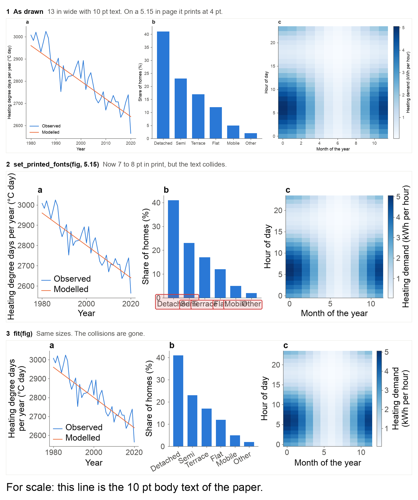
</p>

| Start with | What it is |
|---|---|
| [**Notebook tour**](docs/tour.ipynb) | The problem, then one figure fixed step by step, with every output explained. You only need to know matplotlib |
| [Quick start](#quick-start) | The three lines most figures need |
| [Reference](#1-work-out-the-size) | Each function with a picture of what it does |

## Why

A figure drawn 13 in wide and placed 5.15 in wide on the page is shrunk to 40 % of its size, and
its text shrinks with it. Text set at 10 pt prints at 4 pt. Figures in published papers print at
about 8 pt.

Making the text bigger fixes the size and breaks the layout. Labels land on each other, on the
next panel, or run off the figure. figfont does both jobs:

| | Job | Functions |
|---|---|---|
| 1 | [Work out the size](#1-work-out-the-size) a font prints at, and the size to draw it at | `printed_pt` `drawn_pt_for` `font_scale_for` `panel_width_for` `stitched_width` |
| 2 | [Measure what prints](#2-measure-what-prints), from a figure file or a compiled paper | `figure` `figure_pdf_text` `figure_ocr` `pdf_figure_text` |
| 3 | [Compare with published papers](#3-compare-with-published-papers) | `reference` `verdict` |
| 4 | [Set the printed sizes](#4-set-the-printed-sizes) on a matplotlib figure | `set_printed_fonts` `scale_fonts` |
| 5 | [Pick a size for small panels](#5-pick-a-size-for-small-panels) | `suggest_size` `density` |
| 6 | [Find colliding text](#6-find-colliding-text) | `overlaps` `report_overlaps` |
| 7 | [Fix colliding text](#7-fix-colliding-text) with the smallest change that works | `fit` `clear_notes` |

There is also a [command line](#command-line) for checking figure files and compiled papers.

## Install

```bash
# macOS, with OCR by Apple Vision
pip install "figfont[mac] @ git+https://github.com/jake-casselman/figfont"

# Linux and Windows, with OCR by tesseract (the tesseract command must be installed)
pip install "figfont[tesseract] @ git+https://github.com/jake-casselman/figfont"

# no OCR: vector PDFs and matplotlib figures only
pip install git+https://github.com/jake-casselman/figfont
```

Python 3.10 or later. It installs matplotlib, numpy, pillow and pymupdf. OCR is only used to
measure images (PNG, JPEG) and PDFs whose text is stored as shapes.

## Quick start

```python
import figfont
from figfont.mpl import set_printed_fonts

fig = ...                                    # any matplotlib figure, drawn as usual

set_printed_fonts(fig, printed_width=5.15)   # ticks 7 pt, everything else 8 pt, as printed
figfont.fit(fig, "fig01")                    # clear the collisions the bigger text made
fig.savefig("fig01.pdf")
```

`fit` prints what it changed and what is left:

```text
TEXT FIXED fig01: wrap 2, pads 6, ticks 4
TEXT OK fig01: no overlaps
```

Then measure the file the way a reader will see it:

```python
figfont.figure("fig01.pdf", printed_width=5.15).summary()
# {'name': 'fig01.pdf', 'method': 'text', 'n': 43, 'median_pt': 7.0, 'p10_pt': 7.0, 'p90_pt': 8.0}
```

The full script is [`docs/examples/quickstart.py`](docs/examples/quickstart.py). It draws the
three-panel figure at the top of this page in matplotlib's own style.

The [notebook tour](docs/tour.ipynb) takes that same figure from first draft to the page one step
at a time, and says what each number it prints means. The sections below are the reference for
each function.

---

## 1. Work out the size

Text scales with the figure: `printed size = drawn size × printed width ÷ drawn width`. Five small
functions do this arithmetic in both directions. Widths are in inches and sizes in points.

<p align="center">
  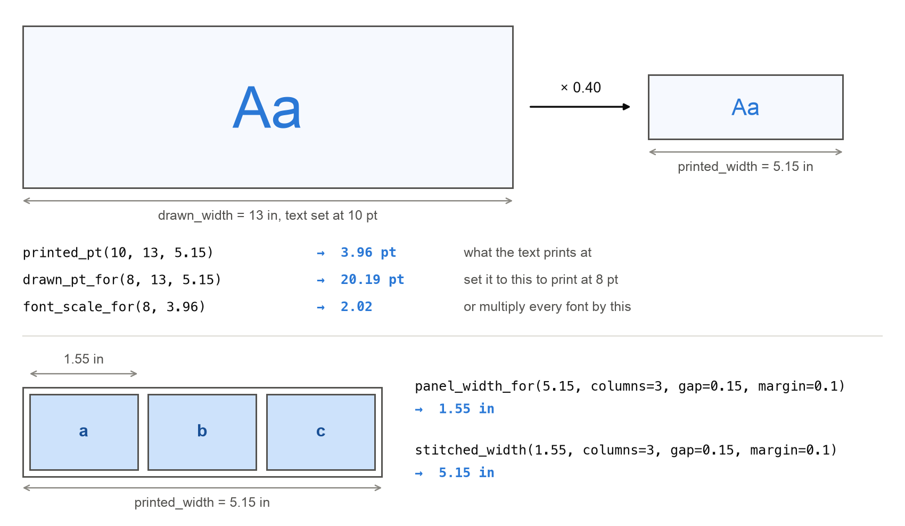
</p>

| Call | Result | Meaning |
|---|---|---|
| `printed_pt(10, 13, 5.15)` | `3.96` | 10 pt text on a 13 in figure prints at 3.96 pt on a 5.15 in page |
| `drawn_pt_for(8, 13, 5.15)` | `20.19` | draw at 20.19 pt to print at 8 pt |
| `font_scale_for(8, 3.96)` | `2.02` | or multiply every font by 2.02 |
| `panel_width_for(5.15, columns=3, gap=0.15, margin=0.1)` | `1.55` | each of three panels gets 1.55 in of the page |
| `stitched_width(1.55, columns=3, gap=0.15, margin=0.1)` | `5.15` | three 1.55 in panels side by side are 5.15 in wide |

`stitched_width` and `panel_width_for` are for figures put together from separate panel images.
The width that counts is the width of the whole stitched figure, not of one panel.

## 2. Measure what prints

`figure(path, printed_width)` returns the size of every piece of text in a figure file, as it
prints when the figure is placed `printed_width` inches wide.

```python
result = figfont.figure("after.pdf", printed_width=5.15)
result.median            # 7.0
result.percentile(10)    # 7.0
result.summary()
# {'name': 'after.pdf', 'method': 'text', 'n': 45, 'median_pt': 7.0, 'p10_pt': 7.0, 'p90_pt': 8.0}
```

It reads the sizes in one of two ways, and `result.method` says which:

| Method | Used for | How | Function |
|---|---|---|---|
| `text` | vector PDFs | the font sizes stored in the file, scaled to the printed width. Exact. | `figure_pdf_text` |
| `ocr` | PNG and JPEG images, and PDFs with fewer than five pieces of stored text | the figure is rendered at its printed width, the text is read off the pixels, and the height of each line is converted to points | `figure_ocr` |

<p align="center">
  
</p>

OCR reads text written across the page and text on its side, such as a y-axis label. Its median
here is 6.7 pt, where the PDF of the same figure says 7.0 pt. See
[Accuracy and limits](#accuracy-and-limits).

### Figures inside a compiled paper

`pdf_figure_text("paper.pdf")` measures the figures where they sit in the finished paper, so it
needs no width. It keeps the text that is not in the body font and lies inside a figure, and
leaves out the body text and the captions.

<p align="center">
  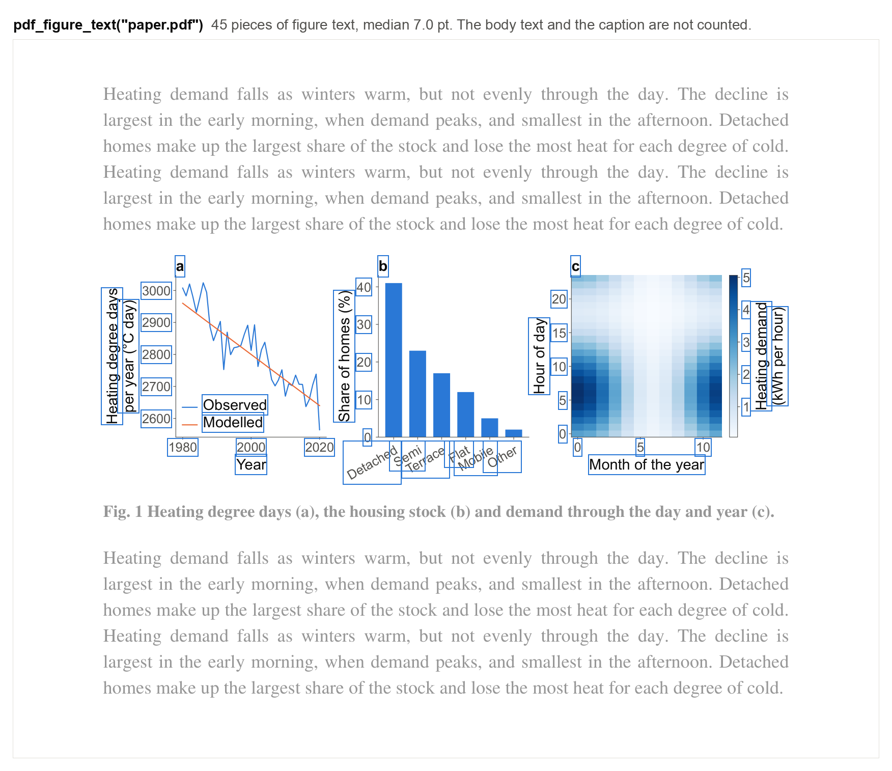
</p>

Every measuring function returns a `Result`:

| Attribute | Meaning |
|---|---|
| `result.sizes` | the printed size of each piece of text, in points |
| `result.n` | how many pieces were found |
| `result.median` | the median size |
| `result.percentile(q)` | any percentile; the 10th shows the smallest text |
| `result.summary()` | a dict with the name, method, count, median, 10th and 90th percentile |

## 3. Compare with published papers

figfont ships with the printed figure-text sizes of 111 journal articles from 62 journals. The
median is 8.0 pt, and half of the papers have a median between 7.4 and 9.0 pt.

<p align="center">
  
</p>

```python
figfont.reference()
# {'papers': 111, 'median_pt': 7.97, 'p10_pt': 6.0, 'p90_pt': 9.96, 'paper_medians_p25_p75': [7.39, 8.97]}

figfont.reference("Nature")
# {'papers': 7, 'median_pt': 7.0, 'p10_pt': 5.5, 'p90_pt': 8.0, 'paper_medians_p25_p75': [6.0, 7.0]}

figfont.verdict(figfont.figure("before.pdf", 5.15))
# {'name': 'before.pdf', 'method': 'text', 'n': 52, 'median_pt': 3.96, 'p10_pt': 3.96, 'p90_pt': 3.96,
#  'reference_median_pt': 7.97, 'reference_range_pt': [7.39, 8.97],
#  'verdict': 'small', 'scale_to_reference': 2.01}
```

`verdict` gives one word for a figure:

| Verdict | When |
|---|---|
| `small` | the median is below the middle half of papers, or a tenth of the text is under 6 pt (`smallest_ok`) |
| `ok` | the median is inside the middle half of papers |
| `large` | the median is above it |

`scale_to_reference` is the factor that would bring the figure's median to the published median.

Pass `journal=` to compare with one journal. The 13 journals with three or more papers have their
own numbers: Atmosphere, Climate Dynamics, Communications Earth & Environment, Energy and
Buildings, International Journal of Climatology, Journal of Advances in Modeling Earth Systems,
Journal of Climate, Nature, Nature Climate Change, Nature Communications, Nature Sustainability,
npj Climate and Atmospheric Science and Scientific Reports. Any other name falls back to all
papers.

The reference file ([`figfont/reference.json`](figfont/reference.json)) holds summary numbers only.

## 4. Set the printed sizes

`set_printed_fonts(fig, printed_width)` sets every piece of text in a matplotlib figure so that it
prints at a chosen size, whatever width the figure was drawn at.

<p align="center">
  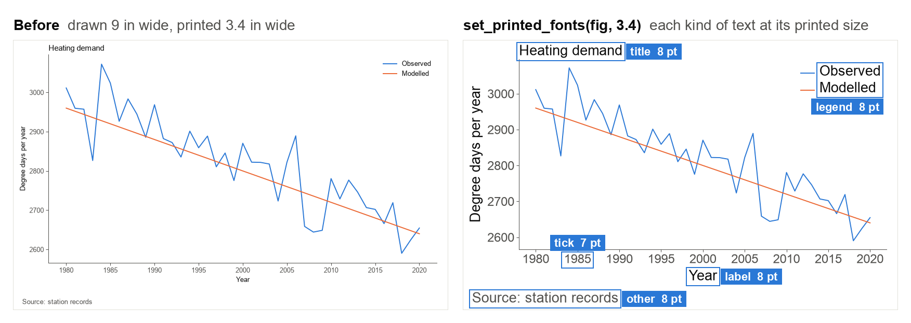
</p>

```python
from figfont.mpl import set_printed_fonts, scale_fonts

set_printed_fonts(fig, printed_width=3.4)                       # the defaults below
set_printed_fonts(fig, printed_width=3.4, sizes={"tick": 8})    # change one of them
```

| Key | Text | Default |
|---|---|---|
| `tick` | tick labels, colour-bar numbers, axis offset text | 7 pt |
| `label` | axis labels and colour-bar labels | 8 pt |
| `title` | panel titles: centre, left and right | 8 pt |
| `legend` | legend entries and legend titles, on a panel or on the figure | 8 pt |
| `other` | everything else: notes in a panel, figure titles, panel letters | 8 pt |

`scale_fonts(fig, factor)` multiplies the size of every piece of text by one factor, which keeps
the differences between them.

## 5. Pick a size for small panels

8 pt is the published average, but it comes mostly from figures with a few large panels. On a grid
of small panels, 8 pt words are as big as the panels and the tick labels run into each other.

`suggest_size(fig, printed_pt=8)` measures how wide each panel is in heights of its own text. It
picks the size that makes the narrowest panel 15 text heights wide, and keeps it between 6 and
8 pt. The grid below would need less than 4 pt, so it gets 6 pt, the smallest size allowed.

<p align="center">
  
</p>

```python
size = figfont.suggest_size(fig, printed_pt=8)    # 6.0 for the grid above
scale_fonts(fig, size / 8)
```

`density(fig)` returns the measurements behind it. `ems_min` is the width of the narrowest panel
in text heights and `panel_ems` the width of each panel. `panels` is the area of each panel's
labels (ticks, axis labels, legend) as a share of its plot area.

The target of 15 was set by eye on the figures of one paper: those that read well had panels at
least 15 text heights wide, and the two that did not had 10 and 11. Change it with `target=`, and
the limits with `low=` and `high=`.

## 6. Find colliding text

`overlaps(fig)` lists every piece of text that touches another piece of text or lies on a
neighbouring panel. With `edges=True` it also lists text that runs off the figure. Leave that
off when saving with `bbox_inches="tight"`, which grows the figure to hold such text.

<p align="center">
  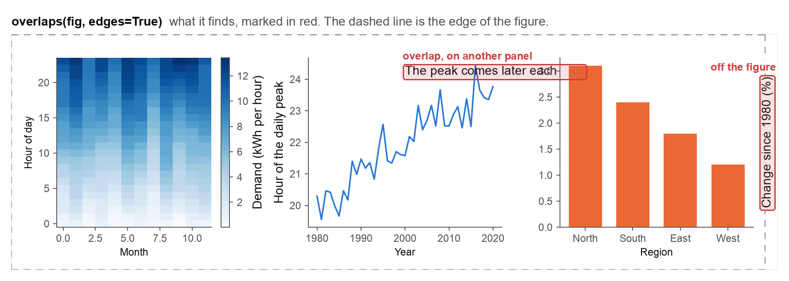
</p>

```python
for text, other, why in figfont.overlaps(fig, edges=True):
    ...                                   # the Text, what it touches, and the kind of collision

figfont.report_overlaps(fig, "peaks.png", edges=True)    # prints them, returns how many
```

```text
TEXT OVERLAP peaks.png: 'The peak comes later each year' <-> '3.0'
TEXT ON ANOTHER PANEL peaks.png: 'The peak comes later each year' <-> a neighbouring panel
TEXT OFF THE FIGURE peaks.png: 'Change since 1980 (%)'
```

Put `report_overlaps` at the end of a figure script and no figure is saved with text on top of
text unseen.

## 7. Fix colliding text

`fit(fig)` finds every collision and fixes it with the smallest change that works. It never
changes a font size, a colour, the data or the wording. It never changes the width of the figure
either, because the width sets the print scale.

```python
left = figfont.fit(fig, "fig04")    # prints what it did; returns the number of collisions left
```

It works through ten steps in this order, and goes round again while anything still touches.

| Step | What it fixes | What it does |
|---|---|---|
| [`cover`](#cover) | a legend lying on the data | moves it to an empty corner, or under the panel |
| [`wrap`](#wrap) | a long title or label that touches other text or runs off the figure | puts it on two lines |
| [`pads`](#pads) | an axis label touching its tick numbers | moves the label out |
| [`letters`](#letters) | a panel letter on a title or label | moves the letters of that column clear |
| [`ticks`](#ticks) | tick labels touching their neighbours | tilts them |
| [`inside`](#inside) | a note running out of its panel | moves it back in |
| [`repel`](#repel) | two notes in one panel on top of each other | pushes them apart |
| [`legends`](#legends) | a legend touching a label or title | moves the legend away |
| [`space`](#space) | text touching the next panel's text | adds space between the panels |
| [`notes`](#notes) | a boxed note cutting into something drawn | moves it the shortest way clear |

### cover

A legend whose text lies on what its panel draws (a map, bars, a filled band) moves to an empty
corner of the panel. When the panel has no empty corner, it goes under the panel with its entries
in a row. Background bands and grid lines do not count as data.

<p align="center">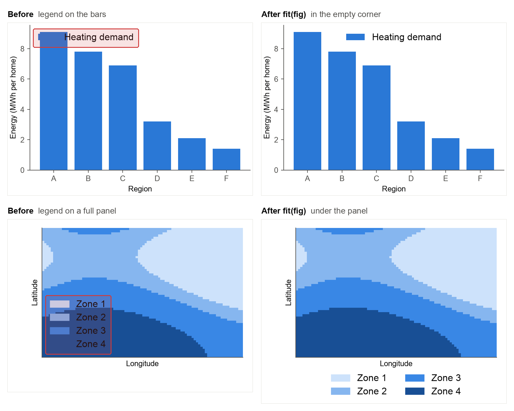</p>

### wrap

A panel title, axis label or colour-bar label that is longer than its panel and touches other
text, or runs off the figure, goes onto two lines. The words stay the same.

<p align="center">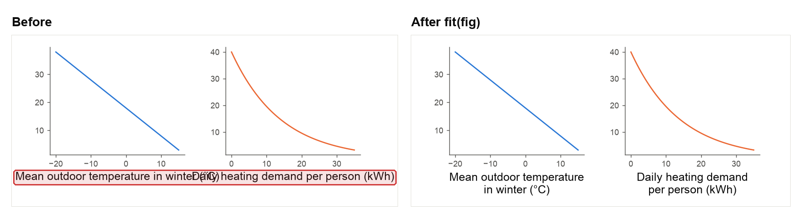</p>

### pads

An axis label or colour-bar label keeps a gap of 0.3 of its font size from its tick numbers. A
gap set in points does not grow when the font does.

<p align="center">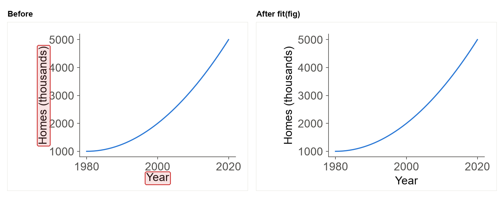</p>

### letters

A panel letter that lies on a title or an axis label moves clear of it. The other letters in its
column move with it, so they stay in line.

<p align="center">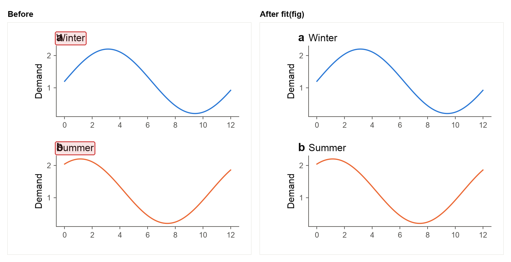</p>

Letters and titles placed with `fig.text` need a tag so `fit` knows which panel they belong to.
The offsets are in figure fractions from the panel's top-left corner:

```python
letter = fig.text(x, y, "a", fontweight="bold")
letter._panel = {"axis": ax, "kind": "letter", "dx": -0.02, "dy": 0.01}    # or "kind": "title"
```

### ticks

Tick labels that touch their neighbours tilt 30 degrees. If they still touch, they tilt to 45, 60
or 90. Two-line tick labels go onto one line first.

<p align="center">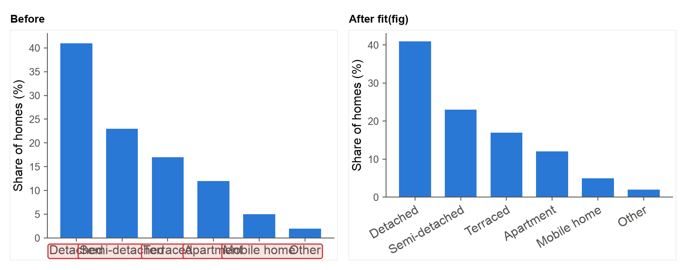</p>

### inside

A note inside a panel that runs past the side of the panel moves back in.

<p align="center"></p>

### repel

Two notes in one panel that touch are pushed apart.

<p align="center"></p>

### legends

A legend that touches a label or a title moves away from it.

<p align="center">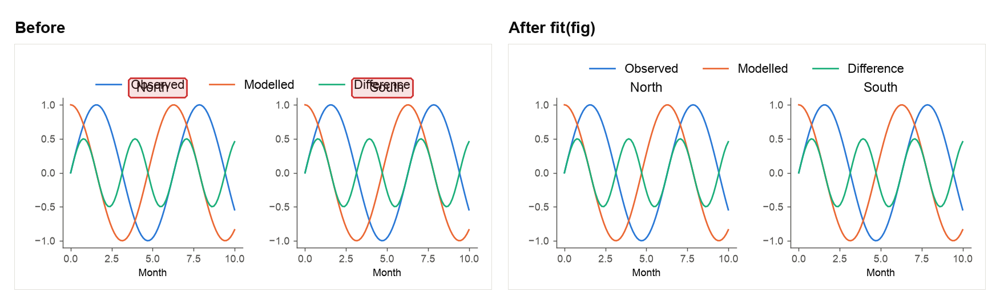</p>

### space

Text that still touches the text of a neighbouring panel gets more space between the panels, a
step at a time. Panels side by side get more space between them. Rows get more space and a
taller figure.

<p align="center">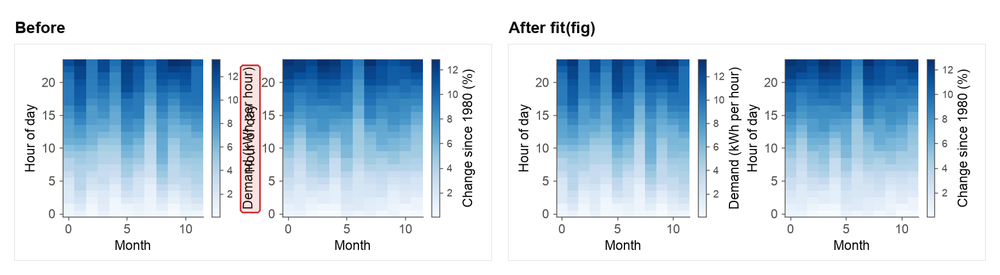</p>

### notes

A note with a box round it, such as a season label on a map, that cuts into the edge of something
drawn (a coast, a curve) moves the shortest way clear of it. Notes set in line with it move too,
so they stay in line. A note never moves onto or over a line drawn right across its panel, such
as an equator or a zero line. In a gap too narrow for the usual clearance, it takes the place
with the most room round it. A note may sit on specks smaller than itself (islands, markers), and
a note written on the data on purpose stays where it is. `clear_notes(fig)` runs this step on its
own.

<p align="center"></p>

On cartopy maps, call `figfont.textfit.pad_cartopy_labels()` once before drawing. Cartopy redraws
its coordinate labels on every draw, so the gap between them has to be cartopy's own rule.

### What fit prints

| Line | Meaning |
|---|---|
| `TEXT DENSITY name: …` | the panel measurements from `density`, before any change |
| `TEXT FIXED name: wrap 2, pads 6` | the steps that changed something, and how many times |
| `TEXT OK name: no overlaps` | nothing touches |
| `TEXT OVERLAP name: 'a' <-> 'b'` | two pieces of text still touch |
| `TEXT ON ANOTHER PANEL name: …` | text still lies on a neighbouring panel |
| `TEXT OFF THE FIGURE name: …` | text runs off the figure (with `edges=True`) |
| `TEXT ON DATA name: …` | a boxed note has no clear place near it and was left where it is |

`fit(fig, quiet=True)` prints nothing and returns the number of collisions left.

---

## Command line

```console
$ figfont check before.pdf after.pdf
published papers: median 7.97 pt, middle half of papers 7.39-8.97 pt
  before.pdf                       median  3.96 pt (1.0 mm caps)  p10  3.96  SMALL  x2.01
  after.pdf                        median  7.00 pt (1.7 mm caps)  p10  7.00  SMALL  x1.14
```

Each line gives the median size, the height of a capital letter at that size, the 10th
percentile, the verdict, and the factor that would bring the median to the published median.

The median of a figure is mostly its tick numbers, because there are more of them than of
anything else. With 7 pt ticks the figure sits just under the middle half of all papers, and
inside the middle half for Nature:

```console
$ figfont check after.pdf --journal "Nature"
published papers: median 7.0 pt, middle half of papers 6.0-7.0 pt
  after.pdf                        median  7.00 pt (1.7 mm caps)  p10  7.00  OK     x1.0
```

For a journal that prints larger, raise the ticks with
`set_printed_fonts(fig, width, sizes={"tick": 8})`.

A width goes after `@`, in inches, or once for all files with `--width`. Without one, the width is
372 pt (5.17 in), a common text width. Images are read with OCR:

```console
$ figfont check after.png@5.15
published papers: median 7.97 pt, middle half of papers 7.39-8.97 pt
  after.png                        median  6.66 pt (1.6 mm caps)  p10  5.63  SMALL  x1.2
```

A compiled paper needs no width:

```console
$ figfont paper paper.pdf
published papers: median 7.97 pt, middle half of papers 7.39-8.97 pt
  paper.pdf                        median  7.00 pt (1.7 mm caps)  p10  7.00  SMALL  x1.14
```

The size to draw at, for a target of 8 pt on a 13 in figure printed 5.15 in wide:

```console
$ figfont scale 8 13 5.15
20.19 pt
```

`--json` gives the same numbers for scripts:

```console
$ figfont check after.pdf --json
[{"name": "after.pdf", "method": "text", "n": 45, "median_pt": 7.0, "p10_pt": 7.0, "p90_pt": 8.0, "reference_median_pt": 7.97, "reference_range_pt": [7.39, 8.97], "verdict": "small", "scale_to_reference": 1.14}]
```

The files used here are in [`docs/examples`](docs/examples).

## All functions

| Function | Returns |
|---|---|
| `printed_pt(drawn_pt, drawn_width, printed_width)` | the size a font prints at |
| `drawn_pt_for(target_pt, drawn_width, printed_width)` | the size to draw at to print at `target_pt` |
| `font_scale_for(target_pt, current_printed_pt)` | the factor to multiply every font by |
| `panel_width_for(printed_width, columns, gap=0, margin=0)` | the width each panel gets on the page |
| `stitched_width(panel_width, columns, gap=0, margin=0)` | the width of panels placed side by side |
| `figure(path, printed_width)` | a `Result`: exact sizes from a vector PDF, otherwise OCR |
| `figure_pdf_text(path, printed_width)` | a `Result` from the text stored in a figure PDF |
| `figure_ocr(path, printed_width, dpi=600)` | a `Result` from OCR |
| `pdf_figure_text(path)` | a `Result` for the figure text of a compiled paper |
| `reference(journal=None)` | the published sizes, for all papers or one journal |
| `verdict(result, journal=None, smallest_ok=6.0)` | the summary, the reference and `small`, `ok` or `large` |
| `figfont.mpl.set_printed_fonts(fig, printed_width, sizes=None)` | nothing; sets each kind of text to its printed size |
| `figfont.mpl.scale_fonts(fig, factor)` | nothing; multiplies every font size |
| `density(fig)` | the width of each panel in text heights, and the share of it that its labels cover |
| `suggest_size(fig, printed_pt=8, target=15, low=6, high=8, step=1)` | the printed size the figure should use |
| `overlaps(fig, edges=False)` | a list of `(text, other, why)` |
| `report_overlaps(fig, name="", edges=False)` | the number of collisions, after printing them |
| `fit(fig, name="", edges=False, quiet=False)` | the number of collisions left |
| `clear_notes(fig)` | the number of boxed notes moved, and a list of those with no clear place |

All of them are in `figfont` except the two in `figfont.mpl`.

## Accuracy and limits

- **Vector PDFs are exact.** The sizes are the ones stored in the file.
- **OCR is close, not exact.** Sizes are within about 7 % of known sizes. On the example figure
  the OCR median is 6.7 pt against 7.0 pt from the PDF. OCR finds fewer pieces of text than the
  PDF holds (29 against 45 here), and very short labels are the least certain.
- **OCR does not measure tilted text.** Text across the page and text on its side are read. Tick
  labels at 30 degrees are skipped.
- **`pdf_figure_text` reads stored text only.** A figure placed in a paper as an image has no
  text to read there. Measure it from the figure file with `figure`.
- **`fit` works on matplotlib figures.** It needs a tag to know which panel a letter or title
  placed with `fig.text` belongs to (see [letters](#letters)).
- **The reference is a sample.** It is 111 papers, and the journals with the most papers are in
  climate, energy and general science. Journals with fewer than three papers are only counted in
  the total.

## Development

```bash
git clone https://github.com/jake-casselman/figfont
cd figfont
pip install -e ".[mac]" pytest
python -m pytest tests
```

Every image on this page is drawn by calling figfont on a real matplotlib figure, so the page
shows what the code does today. Draw them again after a change:

```bash
python docs/make_images.py              # all of them
python docs/make_images.py hero ticks   # only these
```

The map picture needs cartopy and the measuring picture needs OCR.

The notebook keeps its output. Run it again after a change, so the saved output matches the code:

```bash
pip install jupyter cartopy
jupyter nbconvert --to notebook --execute --inplace docs/tour.ipynb
```

## Licence

[MIT](LICENSE) © Jake Casselman
